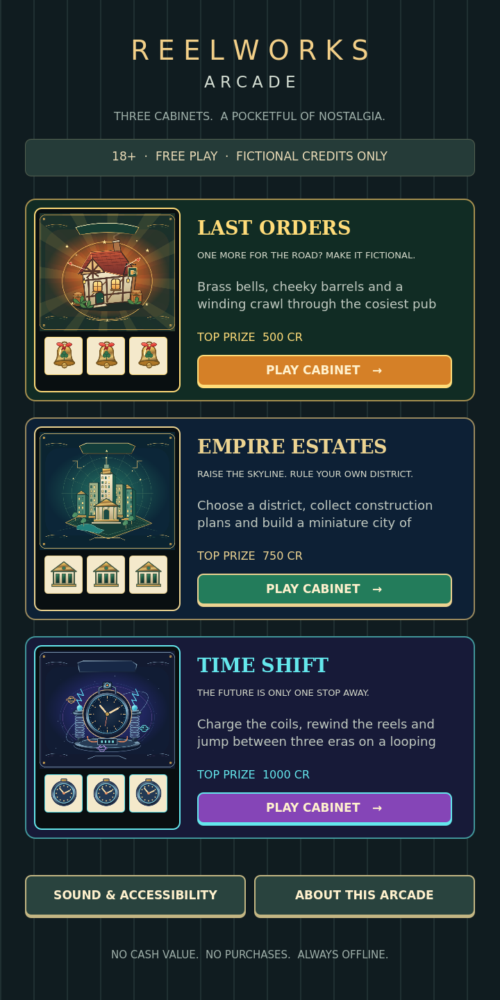
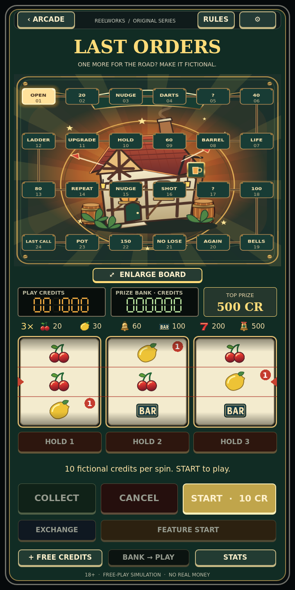
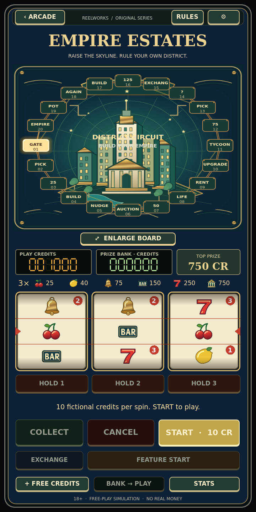
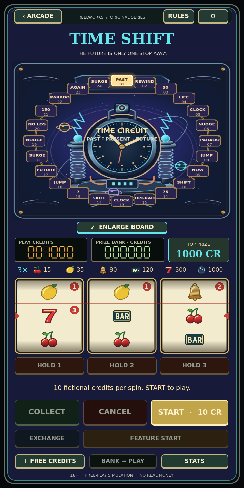

# Development report — 0.1.0

Verified on 2026-10-27 using official **Godot 4.7.2 stable** (`ed1daf0bf`). This is a playable private development build, with real source and a signed Android debug APK; it is not represented as a publication-ready commercial game.

## Implemented

| Area | Delivered behavior |
|---|---|
| Shared engine | Three real strips with three visible positions, independent selected stops, center paytables, actual holds/nudges, overprinted trails, state-gated inputs, integer ledger, collect/exchange, deterministic PRNG and replayable saves. |
| Last Orders | Complete 24-square Pub Crawl and interactive Darts Dash, Lucky Bells, Mystery Barrel, Super Hold, cash ladder and Last Call Streak. Original pub glass, bell symbol, brass/green/orange palette and ambient loop. |
| Empire Estates | 20-square board with three selected district routes, persistent buildings/icons, Property Pick, Auction Offer, Building Bonus, Rent Rush, Tycoon Trail, Empire Streak and Bonus Exchange. Distinct city glass/paytable/strips/ambience. |
| Time Shift | 24-square Past/Present/Future circuit, triple clocks, Time Jump, Temporal Hi-Lo, earned Rewind, Temporal Surge, Super Shift and Paradox Mystery. Distinct clock art/paytable/strips/ambience. |
| Reusable bonuses | All 16 requested rule families; 33 named common/themed feature IDs tested to completion. Shared families are deliberately reused, not separate proprietary machine emulations. |
| Presentation | Illustrated original SVG glass and symbols, native cabinet components, seven-segment displays, staggered mechanical reels, lit controls and lamp chase, dart/clock/pick props, original synthesized effects/ambience, cabinet browsing, rules/stats, board/reel inspection. |
| Mobile and persistence | Portrait scalable canvas, touch controls, Android Back/pause save hooks, sound/music/mute/vibration, motion/flashing/contrast settings, optional 20-minute reminder, atomic save/backup with pending spin/bonus state. |
| Delivery | Exact-version tool installer, temporary signing script, private-only GitHub Actions pipeline, SDK 36 ARM64 export, source and asset provenance, installation/AAB instructions. |

## Validation performed

- Headless import and compilation: passed with no script/parse errors.
- Gameplay suite: **2,338 assertions across 13 groups passed**. Covers all configured paytables, strip alignment/wrapping, holds, nudges, trails/boards, all feature completions, strict/equal hi-lo and protections, collect/exchange/pots, deterministic RNG, malformed input, rapid repeated input, interruption, save/restore and backup recovery.
- Native UI suite: **736 assertions passed** across three cabinets and all 33 feature action sets, including actual held-reel animation, valid control visibility/enabling, board/reel zoom and settings. The UI suite runs muted; a separate real-playback/normal-exit smoke check passed cleanly.
- Simulation: **300,000 paid spins** (100,000 per machine), plus **981,739 transition-loop iterations** through actual feature/control decisions; no stuck-state or negative-accounting failure.
- Rendered inspection: arcade, all three cabinets, board decisions, Darts Dash and Temporal Hi-Lo at 720×1440 under Xvfb/Mesa OpenGL. The virtual display cannot provide a meaningful handset FPS measurement; it emits a V-Sync capability warning.
- Android export: actual signed debug APK; APK v2/v3 signatures and 16 KB ZIP alignment verified. Manifest: `org.reelworks.arcade`, version 0.1.0/code 1, minimum SDK 24, target SDK 36, ARM64 only. Sole requested permission: VIBRATE. No INTERNET permission.
- Physical Android install, touch feel, device FPS, battery and actual OS lifecycle tests: **not performed** (no handset/emulator attached).
- Hosted GitHub Actions run: **not performed** (no remote repository created or pushed). Its exact export script was run locally.

## Measured design mathematics

The report embeds its reproducible seeds and complete player policy. This policy uses offered nudges, selects holds/choices separately from the engine RNG, plays boards/reveals, attempts one favorable-direction hi-lo per paid spin, and uses uniformly timed skill stops. The following are observed virtual returns for that policy, not advertised RTP or real-money expectations.

| Cabinet | Paid spins | Winning paid spins | Banked fictional credits | Observed virtual return |
|---|---:|---:|---:|---:|
| Last Orders | 100,000 | 15,721 | 4,379,940 | 437.994% |
| Empire Estates | 100,000 | 17,105 | 13,469,805 | 1346.980% |
| Time Shift | 100,000 | 15,766 | 6,927,100 | 692.710% |

These tables are deliberately generous in the current free-play prototype and **need balancing**. Empire’s persistent progress and construction modifiers materially increase its return. Multiple strategies/seeds and long-run balance review are next priorities. Board totals can exceed the decorative triple-symbol prize.

Full machine-readable evidence: [gameplay tests](results/gameplay-tests.json), [UI output](results/ui-tests.txt), [simulation distributions and frequencies](results/simulation-300000.json).

## Known limitations and priorities

1. **Phone validation first:** install the APK on the Galaxy S20+, exercise every control, confirm offline play, force-stop/restart during spins and prizes, and assess small utility labels/buttons, cutouts, accessibility, thermal behavior and battery. Android permission/orientation/export metadata is verified; handset behavior is not.
2. **Finish art and interaction polish:** the cabinets have original glass and distinct data/boards, but several bonus families share a common decision panel and reveal pacing. Bespoke full cash ladders, more animated district buildings, richer pub character illustration, and larger skill/reveal sequences would improve the desired historical hardware feel. No claim of professional final-art completion is made.
3. **Balance:** current observed virtual returns greatly exceed 100%; there is no target RTP claim. Review skill accessibility: reduced motion currently freezes the cursor at lamp 1, with its published baseline award.
4. **Module installation:** extra validated JSON definitions load without changing the engine, but require placement in private app data. There is no player-facing importer or custom external-art loader. New rule families still require code.
5. **Release hardening:** debug keys are ephemeral, so installing a later independently signed build may require uninstalling and losing local saves. Implement stable private development signing and tested save migrations before distributing updates. Release AAB/signing/store submission are documented future steps.

All requested gameplay systems have working implementations in this build. Remaining work is primarily balance, device verification, accessibility refinement and the depth of bespoke presentation needed for commercial quality. No payments, advertisements, analytics, accounts, server infrastructure, copied ROMs or copyrighted machine media are included. Nothing was published.

## Screenshots

